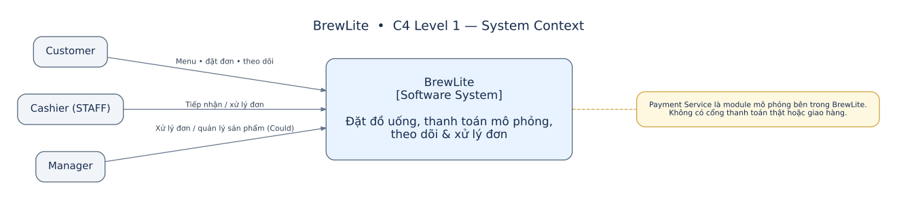
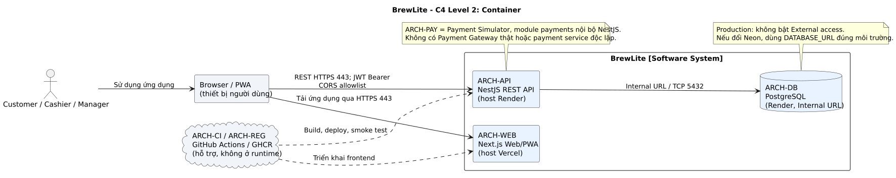

# Kiến trúc phần mềm BrewLite

**Phiên bản:** 1.1 (dự thảo cập nhật 25/11/2026)
**Ngày:** 18/11/2026  
**Phạm vi:** Task 3.1, Assignment 2  
**Nguồn:** `docs/requirements/srs.md`, `context-and-scope.md`, `class-domain.puml`, `sequence-checkout.puml`, kế hoạch nhóm v3.

## 1. Mục tiêu, ràng buộc và phương pháp

BrewLite dùng Next.js (mobile-first/PWA), NestJS, PostgreSQL, Prisma và Docker; ưu tiên dịch vụ miễn phí. NFR-01 đặt mục tiêu hiệu năng; NFR-02 bảo mật; NFR-03 health/khả dụng; NFR-04 giao diện; NFR-05 triển khai; NFR-06 kiểm thử. Render free có cold start; theo kế hoạch v3, Render Postgres free hết hạn sau 30 ngày và giới hạn 1 GB. Các điều kiện gói miễn phí phải kiểm tra lại lúc triển khai.

Chọn **C4** để mô tả ranh giới người dùng/hệ thống (Level 1), nơi thực thi và giao tiếp (Level 2); Level 3 được thay bằng bảng module. Kiến trúc phân lớp vẫn được áp dụng **bên trong** NestJS (controller/service/data access) nhưng không thay thế C4 trong tài liệu này. Thiết kế là **modular monolith**, không tách microservice.

## 2. C4 Level 1: System Context

Tệp nguồn: [`c4-context.puml`](../diagrams/c4-context.puml).

Customer duyệt menu/đặt đơn/thanh toán/theo dõi; Cashier (STAFF) và Manager đăng nhập, xử lý đơn; Manager có thể quản lý sản phẩm nếu triển khai FR-13. C4 Level 1 chỉ biểu diễn **BrewLite như một hệ thống duy nhất** và các actor bên ngoài. Payment Service là module mô phỏng **bên trong BrewLite** và được giải thích ở Level 2 / bảng module Level 3, không vẽ thành hệ thống bên ngoài. Không có Payment Gateway hoặc Shipping Company.

## 3. C4 Level 2: Container

Tệp nguồn: [`c4-container.puml`](../diagrams/c4-container.puml).

Trong Level 2, Browser/PWA **tải frontend** từ ARCH-WEB (Vercel), rồi trực tiếp **gọi REST API** ARCH-API (Render); ARCH-API kết nối ARCH-DB nội bộ. ARCH-PAY chỉ là module trong ARCH-API, không phải container riêng. ARCH-CI/ARCH-REG là hạ tầng hỗ trợ build/deploy, không thuộc runtime.

Sơ đồ triển khai production thuộc **Task 3.2**: [`deployment-production.puml`](../diagrams/deployment-production.puml). Tài liệu này chỉ tham chiếu sơ đồ do thành viên phụ trách Task 3.2 quản lý.

Các thành phần có mã truy vết:

| Mã | Container/module | Triển khai | Giao tiếp |
|---|---|---|---|
| ARCH-WEB | Next.js Web/PWA | Next.js trên Vercel phục vụ ứng dụng; Browser/PWA chạy trên thiết bị người dùng | Vercel phục vụ frontend qua HTTPS 443; Browser/PWA gọi trực tiếp ARCH-API bằng HTTPS 443, JWT Bearer, CORS |
| ARCH-API | NestJS modular monolith | Docker trên Render Web Service | Browser/PWA gọi REST trực tiếp; không có global prefix; PORT từ môi trường |
| ARCH-DB | PostgreSQL | Render Postgres, Internal URL | ARCH-API kết nối nội bộ 5432; không bật External access |
| ARCH-PAY | Payment Service mô phỏng | Module nội bộ ARCH-API | Lời gọi nội bộ, không phải HTTP service riêng |
| ARCH-CI | GitHub Actions | GitHub-hosted runner | CI/CD, GHCR, Render Deploy Hook |
| ARCH-REG | GHCR | GitHub Container Registry | Lưu image API theo semver và SHA |

## 4. Bảng module Level 3 của NestJS API

| Module | Trách nhiệm | Endpoint chính | Domain entity | FR/NFR |
|---|---|---|---|---|
| auth | Đăng ký CUSTOMER, login, JWT, role guard; STAFF/MANAGER qua seed | POST /auth/register, POST /auth/login | User, Role | FR-05, NFR-02 |
| products | Menu, chi tiết, size/topping; quản lý nếu FR-13 | GET /products, GET /products/:id; POST/PATCH /products, PATCH /products/:id/stock nếu mở rộng | Product, ProductSize, Topping | FR-01, FR-02, FR-03, FR-13 |
| orders | Tạo đơn, tính lại giá phía server (FR-06), trừ kho transaction, xem đơn đúng chủ | POST /orders, GET /orders, GET /orders/:id | Order, OrderItem, OrderItemTopping, Product | FR-06, FR-08, FR-10 |
| payments | Payment giả lập, idempotency, cập nhật PAID transaction | POST /payments | Payment, Order | FR-07, NFR-02 |
| staff-orders | Hàng đợi và trạng thái hợp lệ | GET /staff/orders, PATCH /staff/orders/:id/status | Order, OrderStatus | FR-09 |
| health | Kiểm tra ứng dụng và DB | GET /health | Kết nối PostgreSQL | NFR-03 |
| promotions (Should) | Mã giảm giá nếu FR-11 được triển khai | Luồng áp mã khi đặt đơn | Promotion, Order | FR-11 |
| loyalty (Could) | Tích điểm một lần khi COMPLETED | Luồng hoàn tất đơn | LoyaltyTransaction, User, Order | FR-12 |

`Payment Service` là chức năng mô phỏng trong module payments, không tạo container/node riêng. Topping được phép chọn theo Product; snapshot tên/giá món và topping trong OrderItem để bảo toàn lịch sử.

### CORS và cấu hình biến môi trường

Frontend được Vercel phục vụ qua HTTPS nhưng **Browser/PWA của người dùng** gọi trực tiếp NestJS API trên Render. Vì frontend và API khác origin, NestJS phải bật CORS theo allowlist chính xác, không dùng `*` khi gửi Authorization. `CORS_ORIGIN` chứa các origin được phép, phân tách bằng dấu phẩy; khi khởi động phải tách và trim từng origin. Môi trường local dùng `CORS_ORIGIN=http://localhost:3000`; production chỉ dùng origin HTTPS chính thức của web trên Vercel (không dùng URL API hoặc wildcard). Nếu có preview deployment, phải duyệt origin preview riêng trước khi thêm vào allowlist.

`NEXT_PUBLIC_API_URL` được cấu hình tại thời điểm build Next.js để Browser/PWA gọi API HTTPS của Render. `JWT_EXPIRES_IN=1h` ở API theo ADR-003. `JWT_SECRET`, mật khẩu database và các biến chứa secret không được commit. Giỏ hàng thuộc ARCH-WEB ở client (FR-04); server tính lại giá ở bước tạo đơn (FR-06), không tin giá gửi từ client.

## 5. Dữ liệu, transaction và migration

- Prisma là ORM theo D1 (ADR-002). `prisma migrate deploy` áp dụng migration đã commit trong môi trường production, không dùng `migrate dev` hoặc `migrate reset` ở production.
- `POST /orders`: validate JWT/role và body; kiểm tra sản phẩm/tồn kho; server tính lại giá VND nguyên; một `$transaction` tạo Order PENDING, OrderItem và trừ stock theo Product. Thiếu hàng rollback, HTTP 409 OUT_OF_STOCK, không tạo đơn.
- `POST /payments`: kiểm tra quyền sở hữu rồi tra `(userId, idempotencyKey)` + requestHash trước trạng thái PENDING; cùng user/key/body trả nguyên kết quả cũ (kể cả 402); cùng user/key khác body trả 422. Không lấy userId từ body. Cập nhật trạng thái có điều kiện để không tạo hai SUCCESS cho một Order. Ghi Payment và cập nhật Order cùng transaction: SUCCESS chuyển PAID, FAILED giữ PENDING và **không hoàn kho**. `PAYMENT_ALLOW_SIMULATE=false` bỏ qua simulate và mặc định SUCCESS.
- Nếu triển khai FR-10, lazy expiration ở GET /orders, GET /orders/:id, POST /payments; cập nhật có điều kiện và hoàn kho đúng một lần trong transaction. Seed tạo STAFF/MANAGER từ biến môi trường, không commit password.
- DB production không mở truy cập public; Neon free chỉ là phương án dự phòng đổi `DATABASE_URL`, cần chạy migration/seed có chủ đích.

## 6. Quan tâm cắt ngang

| Chủ đề | Quyết định | Kiểm chứng |
|---|---|---|
| Auth | `@nestjs/jwt` + Passport, bcrypt; JWT HS256 payload `sub`, `role`, `iat`, `exp`; hạn 1 giờ, không refresh token; client gửi Bearer; guard kiểm tra role DB hiện tại | 401 thiếu/hết JWT, 403 sai role; 404 với đơn người khác |
| Validation | `class-validator` và logic domain ở backend, UI kiểm tra trước; email, password, name, quantity, size, note theo SRS | HTTP 400 VALIDATION_ERROR |
| Error | Exception filter trả `{statusCode,error,message,code}` | Test contract cho các code đã chốt; không tự đặt code chưa có |
| Logging | Sử dụng Pino cho log có cấu trúc (stdout); không log JWT, password, secret | Kiểm tra log CI/Render |
| Health | `@nestjs/terminus`, GET /health | 200 `{status,db}`, 503 khi DB mất kết nối |
| CORS | Allowlist `CORS_ORIGIN`, local `http://localhost:3000`, production origin HTTPS của Vercel | Kiểm tra preflight và Authorization từ trình duyệt |
| Config | `.env.example` không chứa giá trị thật; secrets trong Render/Vercel/GitHub Environment | Secret scanning, không commit `.env` |
| API docs | `@nestjs/swagger` | Kiểm tra endpoint không có global prefix |
| UX | Mobile-first 375px, PWA manifest, loading/empty/error; polling 5 giây khi mở màn hình theo dõi | FR-09, NFR-04 |

## 7. Trade-off

- Modular monolith đơn giản hóa deploy và transaction so với microservices, đổi lại scale chung và module cần giữ ranh giới rõ.
- REST dễ kiểm thử theo API Contract hơn GraphQL trong phạm vi bài; có thể phát sinh nhiều request.
- Polling 5 giây thay push theo D8 (ADR-006), dễ chạy trên free tier nhưng tăng số request; dừng khi COMPLETED/CANCELLED hoặc rời màn hình.
- Lazy expiration thay cron vì Render free ngủ; đơn hết hạn chỉ được xử lý khi có truy vấn kích hoạt.
- Vercel Git integration deploy web độc lập với CD API; cần smoke test cả hai đầu để phát hiện lệch phiên bản.

## 8. Rủi ro kiến trúc và giảm thiểu

| Rủi ro | Giảm thiểu |
|---|---|
| Render cold start sau thời gian không truy cập | Smoke test retry đủ thời gian; gọi /health trước demo |
| Render Postgres free hết hạn | Tạo gần thời điểm demo; ghi ngày hết hạn trong `docs/deployment.md`; backup/seed; Neon dự phòng |
| Render free có chạy trực tiếp image GHCR không | Kiểm tra ở tuần 3; nếu không, Render build từ Git, GHCR chỉ lưu image có tag; cập nhật sơ đồ theo thực tế |
| Migration không tương thích khi rollback | Migration tương thích ngược; chỉ `migrate deploy`, không reset production |
| Secret lộ qua repo/log | GitHub Environment production, Render env, Vercel env; secret scan |
| Payment bị gọi lại | Unique (userId, idempotencyKey), requestHash, lưu HTTP response, transaction và cập nhật có điều kiện |

## 9. Truy vết kiến trúc

| Thành phần | FR/NFR | Mã nguồn/cấu hình dự kiến | ADR |
|---|---|---|---|
| ARCH-WEB | FR-01..04, FR-08..09; NFR-04 | `apps/web/` | ADR-001, ADR-004, ADR-006 |
| ARCH-API | FR-01..13; NFR-01..03, NFR-06 | `apps/api/src/`, `apps/api/Dockerfile` | ADR-001, ADR-002, ADR-003, ADR-005, ADR-006 |
| ARCH-PAY | FR-07 | `apps/api/src/payments/` | ADR-005, ADR-007 |
| ARCH-DB | FR-05..13; NFR-02, NFR-03 | `apps/api/prisma/`, `docker-compose.yml` | ADR-002, ADR-004 |
| ARCH-CI | NFR-02, NFR-05, NFR-06 | `.github/workflows/` | ADR-001, ADR-004 |
| ARCH-REG | NFR-05 | `.github/workflows/`, `apps/api/Dockerfile` | ADR-004 |

## 10. Đồng bộ thiết kế Sprint 2 (dự thảo)

[ADR-007](adr/007-order-payment-design.md) ghi quyết định về số tiền Int, snapshot, index, FK Payment và migration. PrismaService dự kiến kết nối lười; health cần thử DB up/down và không lộ DSN. Nếu Docker vẫn migrate trước start, container có thể không chạy khi DB down. Đây là thiết kế mục tiêu, chưa khẳng định khớp schema thực tế của Phong.
