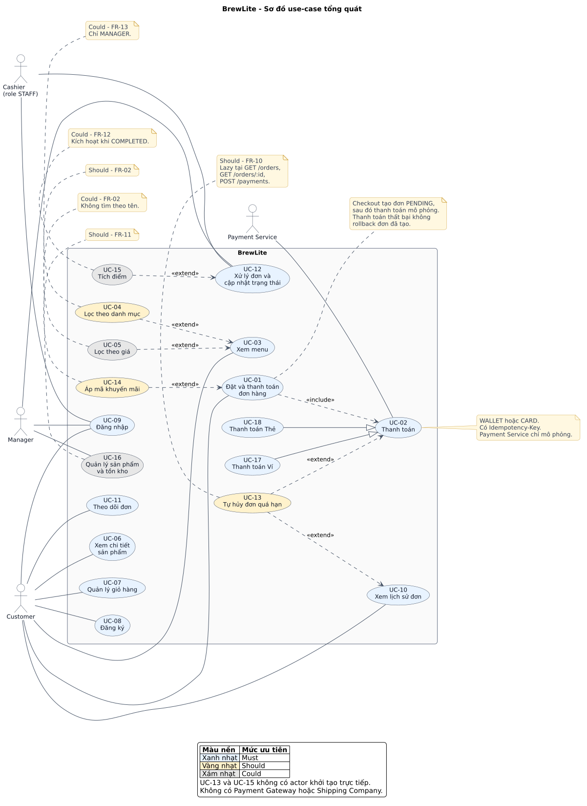

# Đặc tả yêu cầu phần mềm (Software Requirements Specification)

**Phiên bản:** 1.0  
**Ngày:** 16/11/2026  
**Dự án:** BrewLite - Ứng dụng đặt đồ uống tại quán cà phê  
**Tạo phẩm:** Task 1.2 - BrewLite Assignment 2  
**Trạng thái:** Đặc tả yêu cầu v1.0

## 1. Giới thiệu

### 1.1. Mục đích

Tài liệu SRS xác định các yêu cầu chức năng (FR) và phi chức năng (NFR) của BrewLite, mức ưu tiên MoSCoW, tiêu chí chấp nhận có thể kiểm chứng và liên kết truy vết. Tài liệu là cơ sở xây dựng use-case, thiết kế, triển khai, kiểm thử và nghiệm thu trong các task tiếp theo.

### 1.2. Phạm vi

BrewLite hỗ trợ đặt đồ uống để khách hàng nhận tại quán theo luồng:

`Xem menu → Chọn size/topping → Giỏ hàng → Đặt đơn → Thanh toán mô phỏng → Theo dõi đơn`

MVP gồm xem menu và chi tiết sản phẩm; giỏ hàng; xác thực, phân quyền; tạo đơn có transaction và kiểm tra tồn kho; thanh toán mô phỏng có idempotency; lịch sử, theo dõi và xử lý đơn; kiểm thử, Docker, CI/CD và production. Chức năng mở rộng gồm lọc danh mục, tự hủy đơn quá hạn, khuyến mãi, tích điểm và quản lý sản phẩm/tồn kho. Không thực hiện thanh toán thật, giao hàng, đặt bàn, đa chi nhánh, native app, đa ngôn ngữ hoặc push notification.

### 1.3. Tài liệu tham chiếu

| Tài liệu | Nội dung |
|---|---|
| `Assignment2-BrewLite.pdf` | Đề Assignment 2, mục 3.2. |
| `docs/requirements/context-and-scope.md` | Phạm vi, stakeholder, giả định, ràng buộc và rủi ro đã chốt. |
| `docs/requirements/user-stories.md` | Danh sách User Story và Product Backlog. |
| `docs/diagrams/usecase-overview.puml` | Mã nguồn sơ đồ use-case tổng quát. |
| `docs/traceability-matrix.md` | Truy vết yêu cầu, use-case, thiết kế, code và test. |

### 1.4. Quy ước

- `FR-xx`: yêu cầu chức năng; `NFR-xx`: yêu cầu phi chức năng.
- `SCP-IN-xx`: phạm vi MVP; `SCP-EXT-xx`: phạm vi mở rộng; `SCP-OUT-xx`: ngoài phạm vi.
- `US-xx`: User Story; `UC-xx`: Use-case; `FR-xx-ACn` hoặc `NFR-xx-ACn`: tiêu chí chấp nhận.
- MoSCoW: Must (bắt buộc), Should (ưu tiên sau Must), Could (tùy chọn), Won't (không làm).
- Các mã UC trong tài liệu tham chiếu sơ đồ tổng quát; UC-01 là use-case trọng tâm cho Task 1.3.

## 2. Actor và role

| Actor | Role hệ thống | Chức năng |
|---|---|---|
| Customer | CUSTOMER | Xem menu, chọn đồ uống, giỏ hàng, đăng ký/đăng nhập, đặt và thanh toán đơn, xem lịch sử, theo dõi trạng thái. |
| Cashier | STAFF | Đăng nhập, xem hàng đợi và cập nhật trạng thái xử lý đơn. |
| Manager | MANAGER | Đăng nhập, xử lý đơn như STAFF; quản lý sản phẩm/tồn kho nếu triển khai FR-13. |
| Payment Service | Không có role người dùng | Mô phỏng thanh toán Ví/Thẻ và hỗ trợ idempotency. |

Quy tắc phân quyền:

1. Menu và chi tiết sản phẩm cho phép truy cập công khai.
2. Đăng ký công khai chỉ tạo CUSTOMER; STAFF/MANAGER được tạo bằng seed, mật khẩu lấy từ biến môi trường.
3. JWT chứa `sub`, `role`, truyền qua `Authorization: Bearer <JWT>`.
4. API cần xác thực trả 401 khi thiếu/sai/hết hạn JWT; trả 403 khi role không được phép.
5. CUSTOMER chỉ được xem và thao tác trên đơn của mình; STAFF/MANAGER được xử lý trạng thái đơn; chỉ MANAGER được quản lý sản phẩm/tồn kho nếu có FR-13.

## 3. Yêu cầu chức năng

### 3.1. Danh sách yêu cầu

| Mã | Tên | Mô tả | MoSCoW | Tiêu chí chấp nhận | Tham chiếu (SCP, US, UC) |
|---|---|---|---|---|---|
| FR-01 | Xem menu | Customer xem danh sách đồ uống với thông tin cơ bản, giá, danh mục và trạng thái còn bán. | Must | FR-01-AC1 đến AC3 (mục 3.2). | SCP-IN-01; US-01; UC-03 |
| FR-02 | Lọc theo danh mục | Customer lọc sản phẩm theo danh mục; lọc giá là Could, không tìm kiếm theo tên. | Should; lọc giá Could | FR-02-AC1 đến AC3 (mục 3.2). | SCP-EXT-01, SCP-EXT-06; US-02, US-16; UC-04, UC-05 |
| FR-03 | Chi tiết sản phẩm | Xem chi tiết đồ uống, chọn size S/M/L và topping, hiển thị giá cộng thêm. | Must | FR-03-AC1 đến AC3 (mục 3.2). | SCP-IN-02; US-03; UC-06 |
| FR-04 | Giỏ hàng và tính tổng tiền | Thêm, sửa số lượng, xóa đồ uống; giỏ hàng lưu tại client, không đồng bộ server. | Must | FR-04-AC1 đến AC4 (mục 3.2). | SCP-IN-03; US-04; UC-07 |
| FR-05 | Đăng ký, đăng nhập, JWT, phân quyền | Đăng ký CUSTOMER, đăng nhập và kiểm tra quyền CUSTOMER/STAFF/MANAGER. | Must | FR-05-AC1 đến AC4 (mục 3.2). | SCP-IN-04; US-05, US-06; UC-08, UC-09 |
| FR-06 | Đặt đơn | Tính lại giá, kiểm tra tồn kho theo sản phẩm, tạo đơn PENDING và trừ kho trong transaction. | Must | FR-06-AC1 đến AC5 (mục 3.2). | SCP-IN-05; US-07; UC-01 |
| FR-07 | Thanh toán mô phỏng | Thanh toán Ví/Thẻ có idempotency, thành công/thất bại và quyền sở hữu đơn. | Must | FR-07-AC1 đến AC6 (mục 3.2). | SCP-IN-06; US-08; UC-01, UC-02, UC-17, UC-18 |
| FR-08 | Xác nhận và lịch sử đơn | Customer nhận xác nhận, xem danh sách và chi tiết đơn của chính mình. | Must | FR-08-AC1 đến AC4 (mục 3.2). | SCP-IN-07; US-09; UC-01, UC-10 |
| FR-09 | Theo dõi và cập nhật trạng thái | Customer polling trạng thái; STAFF/MANAGER xem và xử lý đơn. | Must | FR-09-AC1 đến AC4 (mục 3.2). | SCP-IN-08; US-10, US-11; UC-11, UC-12 |
| FR-10 | Tự hủy đơn quá 30 phút | Lazy expiration của đơn PENDING, hoàn tồn kho trong transaction, không hoàn trùng. | Should | FR-10-AC1 đến AC3 (mục 3.2). | SCP-EXT-02; US-12; UC-13 |
| FR-11 | Mã khuyến mãi | Áp dụng một mã giảm giá cố định hoặc phần trăm còn hạn. | Should | FR-11-AC1 đến AC3 (mục 3.2). | SCP-EXT-03; US-13; UC-14 |
| FR-12 | Tích điểm | Tích điểm một lần khi đơn COMPLETED. | Could | FR-12-AC1 đến AC3 (mục 3.2). | SCP-EXT-04; US-14; UC-15 |
| FR-13 | Quản lý sản phẩm và tồn kho | MANAGER thêm, sửa, ngừng bán sản phẩm và điều chỉnh tồn kho, không xóa. | Could | FR-13-AC1 đến AC3 (mục 3.2). | SCP-EXT-05; US-15; UC-16 |

### 3.2. Tiêu chí chấp nhận chức năng

Mỗi mã AC là một điều kiện độc lập, có thể liên kết trực tiếp với test case trong ma trận truy vết.

| Mã AC | Tiêu chí chấp nhận có thể kiểm chứng |
|---|---|
| FR-01-AC1 | Khi có sản phẩm, `GET /products` trả 200 và danh sách có thông tin cơ bản, giá, danh mục, trạng thái còn bán. |
| FR-01-AC2 | Khi không có sản phẩm, API trả 200 với danh sách rỗng và UI hiển thị empty state. |
| FR-01-AC3 | Khi đang tải hoặc API lỗi, UI hiển thị loading hoặc error state, không hiển thị dữ liệu sai. |
| FR-02-AC1 | `GET /products?category=...` trả 200, các sản phẩm trả về thuộc danh mục yêu cầu. |
| FR-02-AC2 | Khi danh mục không có sản phẩm, API trả danh sách rỗng và UI hiển thị empty state. |
| FR-02-AC3 | Nếu triển khai lọc giá (Could), chỉ hiển thị sản phẩm thuộc khoảng giá đã chọn. |
| FR-03-AC1 | `GET /products/:id` với sản phẩm tồn tại trả 200 và thông tin size/topping cùng giá cộng thêm. |
| FR-03-AC2 | Sản phẩm không tồn tại trả 404, `code=PRODUCT_NOT_FOUND`. |
| FR-03-AC3 | Size ngoài S/M/L bị từ chối khi gửi dữ liệu đặt hàng; UI không cho chọn size không hợp lệ. |
| FR-04-AC1 | Thêm sản phẩm với size, topping và quantity hợp lệ làm cập nhật giỏ và tổng tiền đúng. |
| FR-04-AC2 | Sửa số lượng hoặc xóa sản phẩm làm tổng tiền được tính lại. |
| FR-04-AC3 | Tải lại trang vẫn khôi phục được giỏ hàng lưu ở client. |
| FR-04-AC4 | Quantity ngoài 1 đến 20 bị từ chối; giỏ rỗng không được gửi đặt đơn. |
| FR-05-AC1 | `POST /auth/register` hợp lệ trả 201 và tài khoản mới có role CUSTOMER. |
| FR-05-AC2 | Dữ liệu đăng ký sai trả 400 `VALIDATION_ERROR`; email trùng trả 409 `EMAIL_TAKEN`. |
| FR-05-AC3 | `POST /auth/login` hợp lệ trả 200 `{accessToken, user}`; sai thông tin trả 401 `INVALID_CREDENTIALS`. |
| FR-05-AC4 | JWT thiếu/sai/hết hạn trả 401; role không được phép trả 403; đăng ký công khai không thể cấp STAFF/MANAGER. |
| FR-06-AC1 | `POST /orders` với JWT CUSTOMER, dữ liệu hợp lệ và đủ tồn kho trả 201, tạo đơn PENDING và trừ kho đúng số lượng. |
| FR-06-AC2 | Không đủ tồn kho trả 409 `OUT_OF_STOCK`; transaction rollback, không tạo đơn và không thay đổi tồn kho. |
| FR-06-AC3 | Sản phẩm không tồn tại trả 404 `PRODUCT_NOT_FOUND`; dữ liệu sai trả 400; mã khuyến mãi không hợp lệ trả 422 `PROMOTION_INVALID` nếu có FR-11. |
| FR-06-AC4 | Thiếu/sai/hết hạn JWT trả 401; STAFF hoặc MANAGER gọi `POST /orders` trả 403. |
| FR-06-AC5 | Server tính lại đơn giá và tổng tiền từ dữ liệu sản phẩm, size, topping; không tin giá client gửi. |
| FR-07-AC1 | `POST /payments` với đơn PENDING, phương thức WALLET/CARD, key hợp lệ và kết quả SUCCESS trả 200, payment SUCCESS, đơn PAID. |
| FR-07-AC2 | Thanh toán FAILED trả 402 `PAYMENT_DECLINED`, đơn giữ PENDING và có thể thử lại bằng key mới. |
| FR-07-AC3 | Cùng key và body trả lại đúng kết quả đã lưu, kể cả 402, không tạo payment mới; cùng key khác body trả 422 `IDEMPOTENCY_KEY_REUSED`. |
| FR-07-AC4 | Thiếu `Idempotency-Key` trả 400; đơn không tồn tại trả 404; đơn không còn PENDING trả 409 `ORDER_NOT_PAYABLE` cho yêu cầu mới. |
| FR-07-AC5 | Thiếu/sai/hết hạn JWT trả 401; STAFF hoặc MANAGER gọi `POST /payments` trả 403; CUSTOMER thanh toán đơn của người khác trả 404. |
| FR-07-AC6 | Khi `PAYMENT_ALLOW_SIMULATE=false`, server bỏ qua trường `simulate` và mặc định kết quả SUCCESS; khi bật `true`, nhận SUCCESS hoặc FAILED để demo. |
| FR-08-AC1 | Tạo đơn thành công hiển thị mã đơn và PENDING; thanh toán thành công hiển thị PAID. |
| FR-08-AC2 | `GET /orders` trả 200, chỉ gồm đơn của người hiện tại, mới nhất trước. |
| FR-08-AC3 | `GET /orders/:id` trả đơn thuộc người dùng; đơn không tồn tại hoặc của người khác đều trả 404. |
| FR-08-AC4 | Thiếu/sai/hết hạn JWT khi truy cập đơn trả 401. |
| FR-09-AC1 | Khi mở màn hình theo dõi, client lấy trạng thái mỗi 5 giây; READY hiển thị thông báo đồ uống sẵn sàng. |
| FR-09-AC2 | Polling dừng khi đơn COMPLETED, CANCELLED hoặc người dùng rời màn hình; không dùng push notification. |
| FR-09-AC3 | `GET /staff/orders` với STAFF/MANAGER trả 200, hiển thị hàng đợi gồm size/topping. |
| FR-09-AC4 | `PATCH /staff/orders/:id/status` cập nhật hợp lệ trả 200; chuyển sai trả 409 `INVALID_STATUS_TRANSITION`; role không hợp lệ trả 403. |
| FR-10-AC1 | Khi gọi `GET /orders`, `GET /orders/:id`, `POST /payments`, đơn PENDING quá 30 phút chuyển CANCELLED và hoàn kho theo từng dòng trong cùng transaction. |
| FR-10-AC2 | Gọi lặp hoặc đồng thời không hoàn kho nhiều lần; chỉ cập nhật nếu đơn vẫn PENDING. |
| FR-10-AC3 | Đơn PAID hoặc trạng thái sau PAID không bị tự hủy. |
| FR-11-AC1 | Mã còn hạn, hợp lệ được áp dụng; `discountAmount` và `totalAmount` phản ánh số tiền giảm. |
| FR-11-AC2 | Mã sai/hết hạn trả 422 `PROMOTION_INVALID`; không áp dụng giảm giá. |
| FR-11-AC3 | Một đơn tối đa một mã; giảm giá phần trăm làm tròn xuống số nguyên VND, không giảm quá tổng tiền trước giảm giá. |
| FR-12-AC1 | Khi đơn chuyển COMPLETED, ghi LoyaltyTransaction bằng `floor(totalAmount / 10000)` điểm. |
| FR-12-AC2 | Gửi lại hoặc xử lý lặp cùng đơn không cộng điểm lần hai. |
| FR-12-AC3 | Đơn chưa COMPLETED không được cộng điểm. |
| FR-13-AC1 | MANAGER gọi `POST /products`, `PATCH /products/:id`, `PATCH /products/:id/stock` hợp lệ được cập nhật dữ liệu, trả 201/200 tương ứng. |
| FR-13-AC2 | CUSTOMER/STAFF gọi các API quản lý trả 403. |
| FR-13-AC3 | Sản phẩm không tồn tại trả 404; ngừng bán không xóa bản ghi. |

FR thuộc Should/Could chỉ trở thành điều kiện nghiệm thu chức năng khi nhóm triển khai. Nếu không làm FR-11/FR-12, quy tắc giảm giá/tích điểm chưa áp dụng; Promotion và LoyaltyTransaction vẫn được thể hiện trong class diagram như mô hình mở rộng theo kế hoạch nhóm.

## 4. Yêu cầu phi chức năng

Các giá trị định lượng dưới đây là **mục tiêu của nhóm**, được kiểm chứng bằng kết quả đo/kiểm thử, không phải số liệu đã đạt.

### 4.1. Danh sách yêu cầu

| Mã | Tên | Mô tả | MoSCoW | Tiêu chí chấp nhận | Tham chiếu (SCP, US, UC) |
|---|---|---|---|---|---|
| NFR-01 | Hiệu năng | API đọc dữ liệu đáp ứng thời gian phản hồi phù hợp khi service đã chạy. | Should | NFR-01-AC1 đến AC2 (mục 4.2). | SCP-IN-01; US-01; UC-03 |
| NFR-02 | Bảo mật | Hash mật khẩu, JWT, phân quyền, bảo vệ secret và database production. | Must | NFR-02-AC1 đến AC4 (mục 4.2). | SCP-IN-04, SCP-IN-09; US-05, US-06, US-18; UC-08, UC-09 |
| NFR-03 | Tính khả dụng (Availability) | Health check, tái tạo DB và xử lý cold start trên Render free. | Must | NFR-03-AC1 đến AC3 (mục 4.2). | SCP-IN-09; US-17, US-18; UC-03 |
| NFR-04 | Tính dễ dùng (Usability) | Mobile-first/PWA, loading/empty/error và validate hai phía. | Must | NFR-04-AC1 đến AC4 (mục 4.2). | SCP-IN-01, SCP-IN-09; US-01, US-17 |
| NFR-05 | Khả năng triển khai | Docker Compose, CI/CD, HTTPS, health, smoke test và rollback. | Must | NFR-05-AC1 đến AC4 (mục 4.2). | SCP-IN-09; US-17, US-18 |
| NFR-06 | Khả năng kiểm thử | Unit, integration, E2E và bằng chứng chạy test. | Should | NFR-06-AC1 đến AC3 (mục 4.2). | SCP-IN-09; US-18; UC-01 |

### 4.2. Tiêu chí chấp nhận phi chức năng

| Mã AC | Tiêu chí chấp nhận có thể kiểm chứng |
|---|---|
| NFR-01-AC1 | Mục tiêu `GET /products` có p95 dưới 500 ms trên 20 lần gọi tuần tự khi API đã khởi động và DB kết nối bình thường, không tính cold start. |
| NFR-01-AC2 | Báo cáo phép đo ghi rõ môi trường, thời điểm, 20 thời gian phản hồi và p95. |
| NFR-02-AC1 | Mật khẩu được hash bằng bcrypt, không lưu plaintext trong DB. |
| NFR-02-AC2 | JWT thiếu/sai/hết hạn trả 401; sai role trả 403; không xem được đơn người khác. |
| NFR-02-AC3 | Repository và log CI không chứa secret; database production không public trực tiếp. |
| NFR-02-AC4 | Seed STAFF/MANAGER đọc mật khẩu từ biến môi trường, không hardcode. |
| NFR-03-AC1 | `GET /health` trả 200 với `{status, db}` khi DB hoạt động và 503 khi mất kết nối DB. |
| NFR-03-AC2 | Có thể tái tạo dữ liệu cần thiết từ PostgreSQL trống bằng migration và seed. |
| NFR-03-AC3 | Sau cold start của Render free, API hoạt động lại; smoke test có retry và thời gian chờ phù hợp. |
| NFR-04-AC1 | Các màn hình chính dùng được ở chiều rộng 375 px, không tràn ngang làm mất thao tác chính. |
| NFR-04-AC2 | Menu có loading/empty/error; biểu mẫu hiển thị lỗi đầu vào. |
| NFR-04-AC3 | Frontend và backend validate dữ liệu; backend trả 400 khi vi phạm quy tắc validate. |
| NFR-04-AC4 | PWA có manifest hợp lệ và cài đặt được trên trình duyệt hỗ trợ; không yêu cầu đồng bộ offline. |
| NFR-05-AC1 | `docker compose up` khởi chạy web, API và PostgreSQL ở local với cấu hình hợp lệ. |
| NFR-05-AC2 | CI chạy install, lint, test, build; PR lỗi lint/test/build bị chặn merge. |
| NFR-05-AC3 | CD tạo image có tag, deploy, migration an toàn, smoke test; có hướng dẫn rollback khi lỗi. |
| NFR-05-AC4 | Frontend production dùng HTTPS, API và `/health` truy cập được; database không public trực tiếp. |
| NFR-06-AC1 | Có unit test cho nghiệp vụ chính, integration test tạo đơn/thanh toán và ít nhất một E2E từ menu đến xác nhận đơn. |
| NFR-06-AC2 | CI chạy được bộ test đã cấu hình và lưu log kết quả. |
| NFR-06-AC3 | Có minh chứng PR thành công và PR bị chặn khi lint/test/build thất bại. |

Việc chặn merge khi lint/test/build lỗi thuộc NFR-05 (Must). NFR-06 (Should) tập trung vào phạm vi và bằng chứng kiểm thử.

## 5. Use-case tổng quát

### 5.1. Sơ đồ

**Tệp nguồn:** `docs/diagrams/usecase-overview.puml`  
**Tệp kết xuất:** `docs/diagrams/usecase-overview.svg`

Sơ đồ đặt các use-case trong một ranh giới BrewLite. Các chức năng Should/Could được tô màu và ghi chú riêng.

### 5.2. Danh sách use-case

| Mã UC | Tên use-case | Actor chính | FR |
|---|---|---|---|
| UC-01 | Đặt và thanh toán đơn hàng | Customer | FR-06, FR-07, FR-08 |
| UC-02 | Thanh toán | Customer, Payment Service | FR-07 |
| UC-03 | Xem menu | Customer | FR-01 |
| UC-04 | Lọc theo danh mục | Customer | FR-02 |
| UC-05 | Lọc theo giá | Customer | FR-02 (Could) |
| UC-06 | Xem chi tiết sản phẩm | Customer | FR-03 |
| UC-07 | Quản lý giỏ hàng | Customer | FR-04 |
| UC-08 | Đăng ký | Customer | FR-05 |
| UC-09 | Đăng nhập | Customer, Cashier, Manager | FR-05 |
| UC-10 | Xem lịch sử đơn | Customer | FR-08 |
| UC-11 | Theo dõi đơn | Customer | FR-09 |
| UC-12 | Xử lý đơn/cập nhật trạng thái | Cashier, Manager | FR-09 |
| UC-13 | Tự hủy đơn quá hạn | Không có actor (kích hoạt bởi lệnh gọi API) | FR-10 |
| UC-14 | Áp mã khuyến mãi | Customer | FR-11 |
| UC-15 | Tích điểm | Không có actor (kích hoạt bởi thay đổi trạng thái) | FR-12 |
| UC-16 | Quản lý sản phẩm và tồn kho | Manager | FR-13 |
| UC-17 | Thanh toán Ví | Customer | FR-07 |
| UC-18 | Thanh toán Thẻ | Customer | FR-07 |

### 5.3. Quan hệ use-case

**Include:** UC-01 `<<include>>` UC-02. Checkout gồm tạo đơn PENDING và thực hiện thanh toán mô phỏng; thanh toán thất bại không rollback đơn đã tạo.

**Extend:**

- UC-04 `<<extend>>` UC-03: lọc theo danh mục khi Customer chọn danh mục.
- UC-05 `<<extend>>` UC-03: lọc theo giá nếu triển khai phần Could.
- UC-14 `<<extend>>` UC-01: áp mã khuyến mãi nếu triển khai FR-11.
- UC-13 (FR-10, Should) là quy tắc tự động kiểm tra đơn quá hạn khi gọi `GET /orders`, `GET /orders/:id` hoặc `POST /payments`; không dùng `<<extend>>` vì đây là xử lý nội bộ gắn với API, không phải mục tiêu tương tác riêng của actor.
- UC-15 (FR-12, Could) là xử lý tự động khi đơn chuyển sang `COMPLETED`; không dùng `<<extend>>` với UC-12 vì cộng điểm là hệ quả nghiệp vụ, không phải nhánh hành vi do actor lựa chọn.

**Generalization:** UC-17 và UC-18 là hai trường hợp chuyên biệt của UC-02, tương ứng WALLET và CARD.

**Actor phụ:** Payment Service gắn với UC-02, chỉ mô phỏng thanh toán. Không có Payment Gateway hoặc Shipping Company. Cashier và Manager phải đăng nhập qua UC-09 trước khi thao tác có phân quyền.

### 5.4. Giới hạn sơ đồ

Sơ đồ không thay thế đặc tả chi tiết UC-01 tại Task 1.3. Các nhánh hết hàng, chưa đăng nhập, sai role, thanh toán đơn của người khác, thanh toán thất bại và idempotency sẽ được mô tả trong đặc tả use-case, activity và sequence diagram.

## 6. Quy tắc nghiệp vụ dùng chung

### 6.1. Quy ước API và dữ liệu

| Thuộc tính | Quy tắc |
|---|---|
| API prefix | Không sử dụng global prefix. |
| ID | UUID, biểu diễn dạng chuỗi. |
| Tiền tệ | VND, số nguyên. |
| Thời gian | ISO 8601 UTC. |
| Xác thực | `Authorization: Bearer <JWT>`. |
| JWT payload | Chứa `sub` và `role`. |
| Định dạng lỗi | `{statusCode, error, message, code}`. |
| Role | CUSTOMER, STAFF, MANAGER. |

### 6.2. Quy tắc validate

| Trường | Quy tắc |
|---|---|
| email | Đúng định dạng email. |
| password | Tối thiểu 8 ký tự, có chữ và số. |
| name | 1 đến 50 ký tự. |
| quantity | Số nguyên 1 đến 20. |
| note | Tối đa 200 ký tự. |
| size | S, M hoặc L. |
| payment method | WALLET hoặc CARD. |

Frontend hiển thị lỗi đầu vào; backend validate lại và trả 400 với định dạng lỗi thống nhất.

### 6.3. Quy tắc tính giá

- `unitPrice = basePrice + size.extraPrice + SUM(topping.price)`
- `lineTotal = unitPrice * quantity`
- `subtotal = SUM(lineTotal)`
- `totalAmount = subtotal - discountAmount`

Backend tính lại giá từ dữ liệu sản phẩm, size, topping; không tin giá client. Mọi giá trị tiền là số nguyên VND. Nếu không triển khai FR-11, `discountAmount = 0` và quy tắc giảm giá chưa áp dụng. Nếu triển khai FR-11, giảm giá phần trăm được làm tròn xuống số nguyên VND và `discountAmount` không vượt `subtotal`.

### 6.4. Quy tắc tồn kho và đặt đơn

1. Tồn kho theo sản phẩm; size và topping không làm thay đổi tồn kho.
2. `POST /orders` kiểm tra tồn kho theo từng sản phẩm; tạo đơn PENDING và trừ kho trong cùng transaction.
3. Nếu thiếu hàng, rollback toàn bộ, trả 409 `OUT_OF_STOCK`, không tạo đơn hoặc trừ kho một phần.
4. Chỉ CUSTOMER được tạo đơn; STAFF/MANAGER trả 403; thiếu/sai JWT trả 401.
5. Đơn của người khác phải được che giấu qua HTTP 404 khi truy cập hoặc thanh toán.

### 6.5. Quy tắc thanh toán và idempotency

`POST /payments` bắt buộc có header `Idempotency-Key` và body gồm `orderId` (UUID), `method` (WALLET/CARD), `simulate` (SUCCESS/FAILED nếu được bật).

1. Thanh toán mới chỉ áp dụng với đơn PENDING của CUSTOMER đang đăng nhập.
2. SUCCESS trả 200 và chuyển đơn sang PAID; FAILED trả 402 `PAYMENT_DECLINED` và giữ PENDING.
3. Cùng key và body trả lại kết quả đã lưu, kể cả 402, không tạo payment mới; cùng key khác body trả 422 `IDEMPOTENCY_KEY_REUSED`.
4. Đơn PENDING sau FAILED có thể thử lại bằng key mới. Yêu cầu mới trên đơn không còn PENDING trả 409 `ORDER_NOT_PAYABLE`.
5. Thiếu key trả 400; đơn không tồn tại hoặc của người khác trả 404; thiếu JWT trả 401; STAFF/MANAGER trả 403.
6. Khi `PAYMENT_ALLOW_SIMULATE=true`, nhận `simulate=SUCCESS` hoặc `simulate=FAILED`. Khi `false`, bỏ qua `simulate` và mặc định SUCCESS. Bật biến này trong môi trường demo để kiểm thử nhánh thất bại và ghi cấu hình trong README.
7. Lưu idempotency key và request hash với ràng buộc duy nhất phù hợp. Khi nhận yêu cầu lặp, ưu tiên xác định kết quả đã lưu trước khi kiểm tra khả năng thanh toán mới.

### 6.6. Quy tắc trạng thái đơn

Luồng thành công: `PENDING → PAID → PREPARING → READY → COMPLETED`.

Luồng hủy: `PENDING → CANCELLED` (chỉ khi triển khai FR-10).

| Từ | Đến | Điều kiện |
|---|---|---|
| PENDING | PAID | Thanh toán thành công. |
| PENDING | CANCELLED | Quá 30 phút nếu triển khai FR-10. |
| PAID | PREPARING | STAFF/MANAGER bắt đầu xử lý. |
| PREPARING | READY | STAFF/MANAGER xác nhận đồ uống sẵn sàng. |
| READY | COMPLETED | STAFF/MANAGER xác nhận khách nhận món. |

Chuyển sai thứ tự, chuyển ngược hoặc hủy đơn không còn PENDING trả 409 `INVALID_STATUS_TRANSITION`. CUSTOMER không được cập nhật trạng thái. Khi READY, Customer thấy thông báo đồ uống đã sẵn sàng; STAFF/MANAGER xác nhận COMPLETED khi khách nhận món.

### 6.7. Quy tắc polling

Frontend lấy trạng thái đơn mỗi 5 giây khi Customer mở màn hình theo dõi. READY hiển thị thông báo nhưng polling vẫn tiếp tục. Polling dừng khi COMPLETED, CANCELLED hoặc rời màn hình. Không có push notification.

### 6.8. Quy tắc tự hủy đơn mở rộng

Chỉ áp dụng nếu triển khai FR-10. Lazy expiration được kiểm tra khi gọi `GET /orders`, `GET /orders/:id`, `POST /payments`. Đơn PENDING quá 30 phút được cập nhật có điều kiện sang CANCELLED và hoàn kho theo từng dòng đơn trong cùng transaction; gọi lặp/đồng thời không hoàn kho trùng. Đơn đã PAID không tự hủy.

Nếu không triển khai FR-10, chỉ ghi nhận giới hạn RSK-15: đơn PENDING bị bỏ dở có thể giữ tồn kho, CANCELLED không có luồng kích hoạt. Không bổ sung thao tác hủy thủ công vào phạm vi MVP. Giới hạn này phải được ghi trong README khi bàn giao.

### 6.9. Quy tắc chức năng mở rộng

- **FR-11:** giảm giá cố định hoặc phần trăm, có hạn dùng, một mã mỗi đơn; làm tròn giảm giá phần trăm xuống số nguyên VND, không vượt tổng tiền trước giảm giá. Không triển khai thì chưa áp dụng.
- **FR-12:** tích `floor(totalAmount / 10000)` điểm khi COMPLETED, một lần cho mỗi đơn. Không triển khai thì chưa áp dụng.
- **FR-13:** MANAGER được thêm, sửa, ngừng bán và điều chỉnh tồn kho; không xóa sản phẩm.

## 7. Ma trận ưu tiên MoSCoW tóm tắt

### 7.1. Yêu cầu chức năng

| Mức ưu tiên | Mã yêu cầu | Số lượng | Phạm vi |
|---|---|---|---|
| Must | FR-01, FR-03 đến FR-09 | 8 | MVP bắt buộc. |
| Should | FR-02 (lọc danh mục), FR-10, FR-11 | 3 | Sau Must. |
| Could | FR-12, FR-13, phần lọc giá của FR-02 | 2 FR và 1 phần mở rộng | Nếu còn thời gian. |
| Won't | Theo SCP-OUT-01 đến SCP-OUT-09 | 9 hạng mục | Không triển khai trong Assignment 2. |

**Chi tiết phạm vi Won't:**

| Mã phạm vi | Nội dung | MoSCoW |
|---|---|---|
| SCP-OUT-01 | Thanh toán thật. | Won't |
| SCP-OUT-02 | Push notification. | Won't |
| SCP-OUT-03 | Giao hàng và Shipping Company. | Won't |
| SCP-OUT-04 | Đặt bàn. | Won't |
| SCP-OUT-05 | Đa chi nhánh. | Won't |
| SCP-OUT-06 | Ứng dụng Android/iOS native. | Won't |
| SCP-OUT-07 | Đa ngôn ngữ. | Won't |
| SCP-OUT-08 | Tìm kiếm sản phẩm theo tên. | Won't |
| SCP-OUT-09 | Hoạt động offline đầy đủ. | Won't |

### 7.2. Yêu cầu phi chức năng

| Mức ưu tiên | Mã yêu cầu | Số lượng |
|---|---|---|
| Must | NFR-02, NFR-03, NFR-04, NFR-05 | 4 |
| Should | NFR-01, NFR-06 | 2 |
| Could | Không có | 0 |
| Won't | Không có NFR riêng | 0 |

### 7.3. Phân chia Sprint dự kiến

| Giai đoạn | Nội dung |
|---|---|
| Sprint 1 | FR-01, API menu, màn hình mobile-first, migration/seed, kiểm thử ban đầu, nền tảng CI. |
| Sprint 2 | FR-03 đến FR-09, thanh toán mô phỏng, trạng thái đơn, E2E, hoàn thiện production. |
| Sau Must | FR-02, FR-10, FR-11, FR-13, FR-12 và lọc giá tùy tiến độ. |

NFR-02 đến NFR-05 triển khai xuyên suốt và bắt buộc hoàn thành trước nghiệm thu. NFR-01 và NFR-06 là Should. Quy tắc ưu tiên Must là FR-01 và FR-03 đến FR-09, không bao gồm FR-02.
